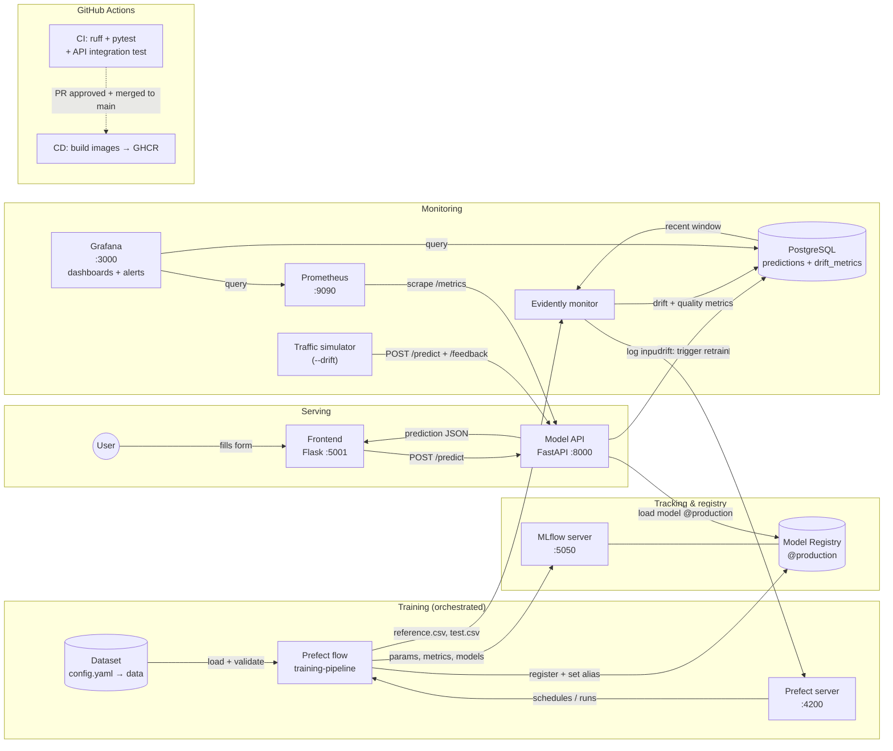

# <Team name> — End-to-end MLOps system

> **INSY 684 Final Project.** Team: _Name (@github-id), Name (@github-id), Name (@github-id), Name (@github-id)_

> ⚠️ **Placeholder dataset.** The stack currently runs on scikit-learn's built-in breast-cancer dataset so
> everything works end to end. When the team picks the real dataset, follow
> [Swapping in your dataset](#swapping-in-your-dataset) and update this README.

## 1. Problem description

_Replace with your problem:_ what is being predicted, who uses the prediction, why it matters, and how
success is measured (metric + target). Placeholder: classify a tumour biopsy as **malignant** or **benign**
from six cell-nucleus measurements; we optimise **F1** on the malignant class.

## 2. Architecture



More detail (request path and drift → retraining path): [docs/architecture.md](docs/architecture.md).

## 3. Run it locally

**Prerequisites:** Docker Desktop (or Docker Engine + Compose v2), ~6 GB free RAM.

```bash
git clone https://github.com/<org>/<repo>.git && cd <repo>
cp .env.example .env              # then edit the passwords
docker compose up -d --build      # starts the whole stack
```

The first start builds the images and runs the initial training flow (about 2–4 minutes). Follow along with
`docker compose logs -f training api`. The API serves predictions as soon as a model has the `@production` alias.

| Service | URL | Notes |
|---|---|---|
| Frontend | http://localhost:5001 | Submit the form, get a prediction |
| Model API docs | http://localhost:8000/docs | `/predict`, `/feedback`, `/health`, `/metrics` |
| MLflow | http://localhost:5050 | Experiments + Model Registry |
| Prefect | http://localhost:4200 | Flow runs, `training-pipeline/retrain` deployment |
| Prometheus | http://localhost:9090 | Raw API metrics |
| Grafana | http://localhost:3000 | Dashboard **MLOps → Model Monitoring** (login from `.env`) |

**Generate traffic and drift**

```bash
docker compose run --rm simulator --requests 400               # normal traffic
docker compose run --rm simulator --requests 400 --drift       # drifted traffic
```

**Retrain manually:** in Prefect, open Deployments → `training-pipeline/retrain` → Run. Alternatively, run
`docker compose exec training python flow.py`.

**Tear down**

```bash
docker compose down        # stop everything, keep data
docker compose down -v     # stop and delete all volumes (fresh start)
```

## 4. Tools used

| Tool | What it does here |
|---|---|
| **docker-compose** | One command (`up` / `down`) starts or stops all services. |
| **Prefect** | Runs the training pipeline as a flow (`services/training/flow.py`): load → validate → split → train candidates → select → register → promote. Also serves the `retrain` deployment that drift triggers. |
| **MLflow** | Tracks every candidate as a run (params, val/test metrics, baseline, model artefact). The best model is registered as `tumour-classifier` and gets the `@production` alias if it beats the current one. |
| **FastAPI** (model API) | Its own container. Loads `models:/…@production`, validates input against config bounds, logs predictions to Postgres, exposes Prometheus metrics, and hot-reloads when the alias changes. |
| **Flask** (frontend) | Its own container. A form generated from `config.yaml` calls the API over HTTP and shows a readable label + probability, with friendly error messages. |
| **Traffic simulator** | A Python script that replays unseen test rows, sends ground truth to `/feedback`, and with `--drift` shifts the features configured in `config.yaml`. |
| **Evidently** | The monitor container computes dataset drift (vs. training reference) and classification quality every 30 s. |
| **PostgreSQL** | Stores MLflow metadata, logged predictions (`predictions`) and Evidently results (`drift_metrics`). |
| **Prometheus** | Scrapes the API's `/metrics`: request count, latency histogram, errors and predictions by class. |
| **Grafana** | A dashboard and alert rules provisioned as code (`monitoring/grafana/`). Alerts: data drift, error rate and p95 latency. |
| **GitHub Actions** | CI runs ruff, the unit tests and an API container integration test on every PR. CD builds and pushes all images to GHCR on merge to `main`. |

## 5. Monitoring results

_Add your screenshots to `docs/screenshots/` and keep these links._

| Normal traffic | After drift injection |
|---|---|
|  |  |

| Drift alert firing | Retraining triggered (Prefect) |
|---|---|
|  |  |

_Describe what changed:_ for example, drift share went from below 50 % to above 50 %, the alert fired, Prefect started
`training-pipeline/retrain`, and the API moved from model v1 to v2.

## 6. Tests

```bash
python -m venv .venv && source .venv/bin/activate
pip install -r requirements-dev.txt
ruff check .
pytest tests/unit -v
API_URL=http://localhost:8000 pytest tests/integration -v   # with the stack running
```

| File | Covers |
|---|---|
| `test_data_validation.py` | required columns present, no missing target, binary target |
| `test_preprocessing.py` | known input → expected scaled / one-hot features, imputation |
| `test_model_quality.py` | model beats the majority-class baseline; outputs in valid range; raising a risk feature raises the probability |
| `test_drift.py` | injected drift is flagged by Evidently and triggers retraining (with cooldown) |
| `test_api.py`, `test_frontend.py` | bad input → 422, readable output, metrics exposed, friendly frontend errors |
| `integration/test_api_container.py` | starts the real API container and sends it requests (run in CI) |

## 7. Team workflow

See [CONTRIBUTING.md](CONTRIBUTING.md): one feature branch per change, a PR reviewed by a teammate with
real comments, CI must pass, merge commit or rebase (no squash), and no secrets in the repo.

## Swapping in your dataset

1. Put the CSV in `data/raw/` and set `data.source: csv`, `data.path` and `data.target` in `config.yaml`.
   The target must be 0/1. For multi-class or regression, ask your team to adapt `modeling.py`.
2. List the feature columns under `features.numeric` and `features.categorical`, and set `defaults`
   (used by the form) and `bounds` (used for API validation).
3. Set `features.monotonic_increasing` to a feature that should raise the positive-class probability.
4. Choose 2–3 features under `drift.inject` and set `classes`, `model.registered_name` and `project`.
5. Run `pytest tests/unit`, then `docker compose down -v && docker compose up -d --build`.
