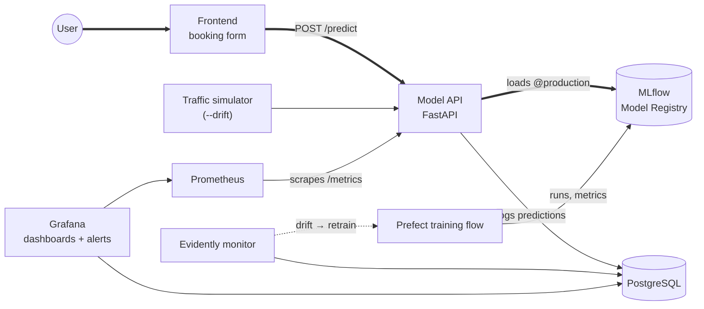

# Hotel Cancellation Forecasting — INSY 684 MLOps project

Predicting, at booking time, whether a hotel reservation will be canceled, and taking that model
through an MLOps workflow (packaging, serving, deployment and a dashboard).

**Live dashboard:** https://hotel-cancelation-dashboard.vercel.app/

## Data

[Hotel Booking Demand](https://doi.org/10.1016/j.dib.2018.11.126) (Antonio, Almeida & Nunes, 2019):
119,390 bookings from a city hotel and a resort hotel in Portugal, arrivals July 2015 – August 2017.
After removing 31,994 exact duplicates and 167 bookings with no guests or a negative price,
**87,229 bookings** remain, 27.5% of them canceled.

The CSV is not committed. Put `hotel_bookings.csv` in `frontend/data/raw/` to rebuild the dashboard data.

## Model

Final model (Task 2, `is_canceled`): an equal-weight average of two pipelines, with a decision threshold of 0.45.

| | |
|---|---|
| Members | Extra Trees (features V2) + MLP neural network (features V0) |
| Features | booking-time only; 7 post-booking / leaky columns removed (reservation status and date, assigned room, booking changes, days on waiting list, parking spaces, special requests) |
| Split | chronological 70 / 15 / 15 by arrival date; final refit on train + validation |
| Threshold | 0.45, chosen on validation by best F0.5 |

**Test period (May 5 – Aug 31, 2017, 17,088 bookings):**

| ROC AUC | Brier | Precision | Recall | F1 |
|---|---|---|---|---|
| 0.804 | 0.170 | 0.609 | 0.520 | 0.561 |

The saved model is `model/cancellation_model.joblib`. Loading it needs `hotel_model.py` importable
(it defines the custom classes the pickle refers to); a copy is in `frontend/pipeline/`.

## Architecture



Full diagram, the role of each tool and the request path: [docs/architecture.md](docs/architecture.md).

## Repository layout

```
model/
  cancellation_model.joblib   trained final ensemble
frontend/                     results dashboard (see below)
  pipeline/
    hotel_model.py            model components (feature engineering, pipelines, ensemble)
    train.py                  cleaning, chronological split, training, export to joblib
    build_data.py             retrains the model and writes the dashboard's data
  data/processed/             dashboard data (aggregates only)
  web/                        Next.js site
api/                          prediction API          (placeholder)
notebook/                     analysis notebook       (placeholder)
app.py, DockerFile            app entry point, image  (placeholders, empty)
.workflows/                   CI/CD                   (placeholder)
```

## Dashboard (`frontend/`)

A static Next.js site with three pages:

- **Bookings** – volumes, cancellation rate and price by month and hotel, lead time, stay length, countries, data cleaning steps.
- **Who cancels?** – cancellation rate by lead time, deposit, market segment, customer type, guest history.
- **Model** – train/validation/test timeline, ROC and precision–recall curves, confusion matrix, an interactive threshold slider,
  calibration, score distribution, which inputs the model relies on, and performance by group.

It shows precomputed results only; it does not call the model live.

### Run it locally

```bash
cd frontend/web
npm install
npm run dev            # http://localhost:3000
```

### Rebuild its data (after a model change)

```bash
pip install -r frontend/pipeline/requirements.txt
python frontend/pipeline/build_data.py    # retrains, checks the test metrics, writes data/processed/*.json
```

Then commit `frontend/data/processed/` and `frontend/web/src/data/`.

### Deploy

Vercel, with **Root Directory** set to `frontend/web`, framework Next.js, no environment variables.
Each push to the deployed branch redeploys.

### Train the model on its own

```bash
python frontend/pipeline/train.py --data frontend/data/raw/hotel_bookings.csv --out model/cancellation_model.joblib
```

## Team

Aleksander - Docker connection
Alessandro - API 
Justin - Project management
Eglantine - Dashboard (UI)
Alek - CI/CD
Daniel - GitHub setup

