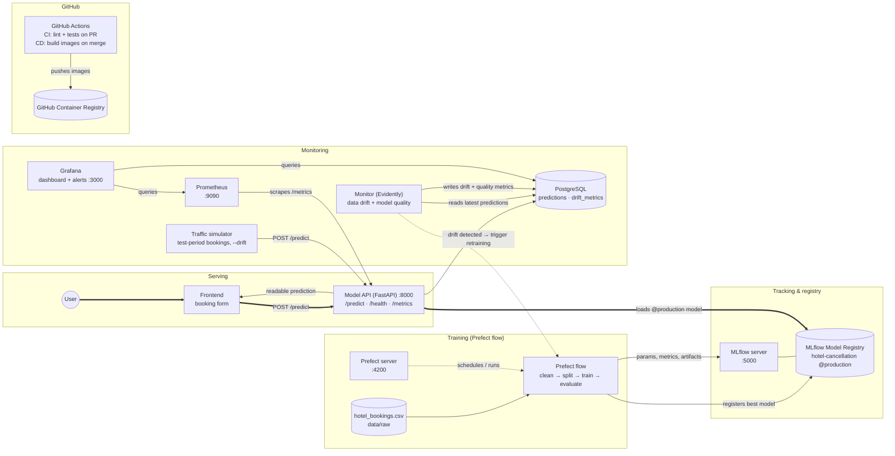

# Architecture

Target design of the system, from data to monitoring. Arrows show what calls or feeds what.
The user's request path is **User → Frontend → Model API → Model** (thick arrows).

## Components

| Tool | Role in this project |
|---|---|
| **docker-compose** | `docker compose up` starts every service below; `docker compose down` stops them. |
| **Prefect** | Runs training as a flow (clean → chronological split → train → evaluate → register), not a notebook. The monitor can trigger it again when drift is detected. |
| **MLflow** | Tracks every training run (parameters, metrics, artifacts) and holds the final model in the Model Registry; the API serves the version marked `@production`. |
| **Model API (FastAPI)** | Validates a booking, returns the cancellation probability and a readable label, logs the prediction to Postgres and exposes `/metrics` for Prometheus. Bad input returns HTTP 422. |
| **Frontend** | A web form in its own container; it calls the API and shows the prediction. |
| **Traffic simulator** | Sends unseen bookings (test period, from 2017-05-05) to the API; `--drift` shifts lead time, price, market segment and country. |
| **PostgreSQL** | Stores logged predictions and Evidently's metrics (`monitoring` database) and MLflow's metadata (`mlflow` database). |
| **Evidently** | Compares recent predictions' inputs with the training data (data drift) and computes model quality when true outcomes are known. |
| **Prometheus** | Scrapes the API's `/metrics`: request count, latency, errors, predictions by outcome. |
| **Grafana** | Dashboard and alerts over Prometheus and Postgres, provisioned from `monitoring/grafana` (saved as code). |
| **GitHub Actions** | CI runs lint (ruff) and tests on every pull request; CD builds the Docker images on merge to `main` and pushes them to GitHub Container Registry. |
| **Results dashboard (Vercel)** | Separate from the stack: a static site with the data analysis and the final model's test results (`frontend/web`). |

## Request path

1. The user fills in the booking form on the frontend.
2. The frontend sends it as JSON to `POST /predict` on the model API.
3. The API validates it, runs the registered model and answers with the probability and a label
   ("Likely to cancel" above the 0.45 threshold).
4. The API logs the request to Postgres and updates its Prometheus metrics.
5. The monitor periodically runs Evidently on the latest predictions; Grafana shows the results and alerts on drift.
