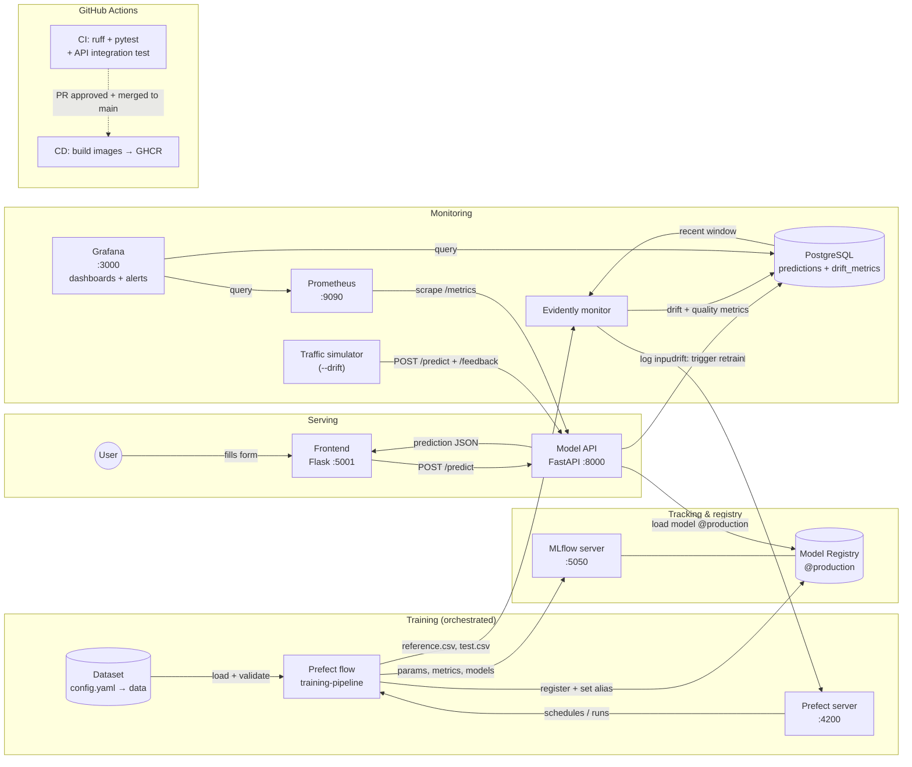

# Architecture

Diagram-as-code (Mermaid). GitHub renders it automatically. Keep it in sync
with `docker-compose.yml` when you change services.

## Request path (user → model)

1. The user submits the form in the **frontend** container (`:5001`).
2. The frontend validates the input and sends `POST /predict` to the **API** container (`http://api:8000`).
3. The API validates the payload against `config.yaml` bounds (bad input → HTTP 422), runs the model
   loaded from the **MLflow registry** (`models:/<name>@production`) and returns the label + probability.
4. The API logs the request to **PostgreSQL** and updates its **Prometheus** metrics.
5. The frontend shows a readable result (e.g. "Malignant — 87%").

## Drift → retraining path

1. The **simulator** sends unseen test rows (optionally drifted) and reports the true label via `/feedback`.
2. Every 30 s the **Evidently monitor** compares the latest window of predictions to the training
   reference and writes drift share + accuracy/F1 to `drift_metrics`.
3. **Grafana** shows the change and fires the *Data drift detected* alert.
4. The monitor triggers the Prefect deployment `training-pipeline/retrain`, which retrains on the original
   data plus labelled production data and promotes the new version if it scores at least as well.
5. The API notices the alias moved and hot-reloads the new model version.
